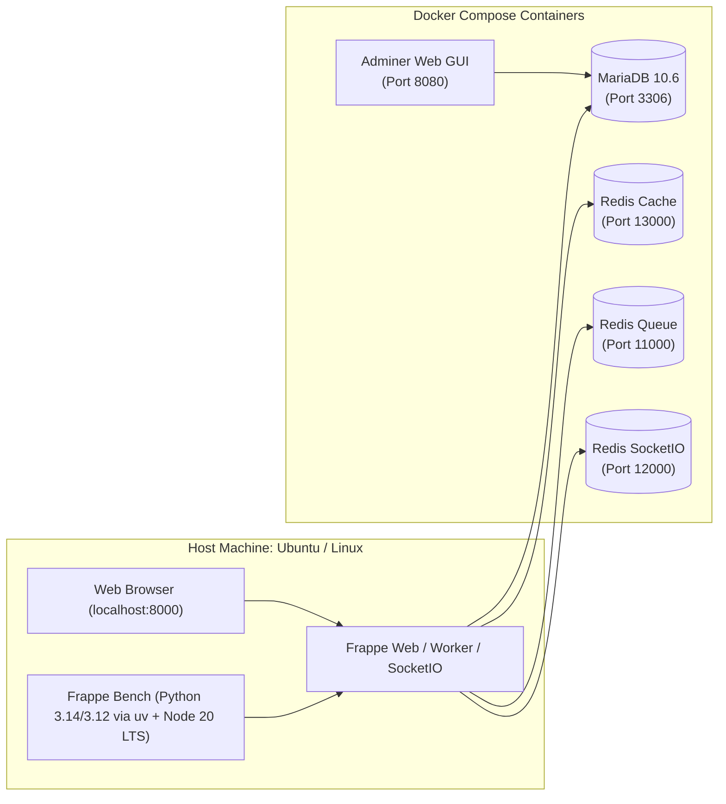

# 🚀 Complete Frappe Framework Setup Guide (Team Reference)

> **Document Purpose:** This guide details the complete, production-ready local setup for Frappe Framework (v15 / v16 develop). It combines containerized database & Redis services via Docker Compose with a host-level Python environment managed by `uv` (with `uv venv` and `uv python pin`) and Node.js managed by `nvm`. It also includes common pitfalls and step-by-step bug fixes encountered during setup.

---

## 📑 Table of Contents
1. [Architecture Overview](#1-architecture-overview)
2. [Prerequisites & System Packages](#2-prerequisites--system-packages)
3. [Step 1: Docker Compose Setup (DB & Redis)](#3-step-1-docker-compose-setup-db--redis)
4. [Step 2: Node.js & Yarn Setup (via NVM)](#4-step-2-nodejs--yarn-setup-via-nvm)
5. [Step 3: Python Environment & Bench Setup (via uv)](#5-step-3-python-environment--bench-setup-via-uv)
6. [Step 4: Initialize Frappe Bench](#6-step-4-initialize-frappe-bench)
7. [Step 5: Adjust Procfile for Docker Redis](#7-step-5-adjust-procfile-for-docker-redis)
8. [Step 6: Create New Frappe Site](#8-step-6-create-new-frappe-site)
9. [Step 7: Multi-Tenancy & Host Resolution](#9-step-7-multi-tenancy--host-resolution)
10. [Step 8: Running Frappe & Daily Workflow](#10-step-8-running-frappe--daily-workflow)
11. [Troubleshooting & Bug Fixes Index](#11-troubleshooting--bug-fixes-index)

---

## 1. Architecture Overview



- **Database & Queue Services:** Run inside Docker (isolated, easily restartable, persistent via volumes).
- **Application Code & Bench:** Runs directly on the Host using `uv` (isolated Python workspace) and `nvm` (Node version manager).

---

## 2. Prerequisites & System Packages

Before starting, install essential system packages, build tools, and MariaDB client libraries on Ubuntu/Debian:

```bash
sudo apt update
sudo apt install -y git curl build-essential libmariadb-dev mariadb-client
```

> [!IMPORTANT]
> **Why `mariadb-client` is mandatory on the host:**
> Even though MariaDB runs in a Docker container, `bench new-site` requires the `mariadb` (or `mysql`) CLI command on the **host machine** to import initial SQL schemas into the container database.

---

## 3. Step 1: Docker Compose Setup (DB & Redis)

Create a directory (e.g. `1.Installation_part`) and save the following `docker-compose.yml`:

```yaml
services:
  mariadb:
    image: mariadb:10.6
    container_name: frappe-mariadb
    restart: unless-stopped
    environment:
      MYSQL_ROOT_PASSWORD: root
    command:
      - --character-set-server=utf8mb4
      - --collation-server=utf8mb4_unicode_ci
      - --skip-character-set-client-handshake
      - --skip-innodb-read-only-compressed
      - --max-allowed-packet=64M
    ports:
      - "3306:3306"
    volumes:
      - mariadb_data:/var/lib/mysql

  redis-cache:
    image: redis:6.2-alpine
    container_name: frappe-redis-cache
    restart: unless-stopped
    ports:
      - "13000:6379"

  redis-queue:
    image: redis:6.2-alpine
    container_name: frappe-redis-queue
    restart: unless-stopped
    ports:
      - "11000:6379"

  redis-socketio:
    image: redis:6.2-alpine
    container_name: frappe-redis-socketio
    restart: unless-stopped
    ports:
      - "12000:6379"

  adminer:
    image: adminer:latest
    container_name: frappe-db-adminer
    restart: unless-stopped
    ports:
      - "8080:8080"

volumes:
  mariadb_data:
```

### Start the Services:
```bash
docker-compose up -d
```

### Verification & Adminer Web GUI:
1. Check containers: `docker-compose ps` (all should be `Up`).
2. Open Adminer in browser: `http://localhost:8080`
   - **System:** `MySQL / MariaDB`
   - **Server:** `mariadb`
   - **Username:** `root`
   - **Password:** `root`
   - **Database:** *(leave empty)*

---

## 4. Step 2: Node.js & Yarn Setup (via NVM)

Frappe requires Node.js (LTS recommended) and Yarn (Classic 1.x) to compile desk assets.

```bash
# 1. Install Node 20 LTS and set as default
nvm install 20
nvm use 20
nvm alias default 20

# 2. Install Yarn 1.x globally
npm install -g yarn

# 3. Verify installations
node -v   # Should show v20.x
yarn -v   # Should show 1.22.x
```

---

## 5. Step 3: Python Environment & Bench Setup (via uv)

`uv` is Astral's blazing-fast Python package and project manager. We use it to download Python, pin the version, manage virtual environments, and install `frappe-bench`.

### 1. Install `uv`
```bash
curl -LsSf https://astral.sh/uv/install.sh | sh
source $HOME/.local/bin/env
```

### 2. Install Python via `uv`
```bash
# Install Python (e.g. 3.14 or 3.12)
uv python install 3.14

# List installed python versions
uv python list
```

### 3. Initialize & Pin Python in Project Workspace
Inside your workspace folder (e.g., `1.Installation_part`):
```bash
# Initialize uv project with desired python version
uv init --python 3.14

# Pin the python version for this project
uv python pin 3.14

# Create virtual environment
uv venv

# Activate the virtual environment
source .venv/bin/activate

# Verify active Python
python --version
```

### 4. Install `frappe-bench` via `uv tool`
Install `frappe-bench` globally referencing the desired Python version:
```bash
uv tool install frappe-bench --python 3.14

# Verify bench CLI
bench --version
```

---

## 6. Step 4: Initialize Frappe Bench

Use `bench init` with the `--python` path located by `uv python find`:

```bash
# Option A: Frappe 16 (Next-Gen Develop Branch)
bench init --frappe-branch develop --python $(uv python find 3.14) frappe-bench

# Option B: Frappe v15 (Latest Stable Production Release)
bench init --frappe-branch version-15 --python $(uv python find 3.14) frappe-bench
```

Move into the newly created bench directory:
```bash
cd frappe-bench
```

---

## 7. Step 5: Adjust Procfile for Docker Redis

Frappe bench defaults to launching its own `redis-server` instances on ports `11000` and `13000`. Since Docker is already running Redis on these ports, running `bench start` will fail with `Address already in use`.

Open `frappe-bench/Procfile` and comment out the two redis lines:

```text
# redis_cache: redis-server config/redis_cache.conf
# redis_queue: redis-server config/redis_queue.conf

web: bench serve --port 8000
socketio: bench socketio
watch: bench watch
schedule: bench schedule
worker: bench worker 1>> logs/worker.log 2>> logs/worker.error.log
```

---

## 8. Step 6: Create New Frappe Site

Create your local site connected to the Docker MariaDB container:

```bash
bench new-site mysite.local --db-host 127.0.0.1 --db-port 3306 --db-root-password root
```

- When prompted for **Administrator password**, enter your desired web login password (e.g., `admin`).

---

## 9. Step 7: Multi-Tenancy & Host Resolution

Frappe uses HTTP `Host` headers to select which site to serve. If you open `http://localhost:8000`, Frappe looks for a site named `localhost`. Since your site is `mysite.local`, Frappe will return `Not Found: localhost does not exist`.

### Solution (Choose either or both):

#### Solution A: Create a `localhost` Symlink (Quickest)
Inside `frappe-bench/`:
```bash
ln -s mysite.local sites/localhost
echo "mysite.local" > sites/currentsite.txt
```
👉 Now **`http://localhost:8000`** directly opens `mysite.local`.

#### Solution B: Add domain to `/etc/hosts` (Standard Frappe multi-tenant practice)
```bash
echo "127.0.0.1 mysite.local" | sudo tee -a /etc/hosts
```
👉 Now **`http://mysite.local:8000`** works seamlessly.

---

## 10. Step 8: Running Frappe & Daily Workflow

### Start the development server:
```bash
bench start
```

### Accessing the System:
- URL: **`http://localhost:8000`** (or `http://mysite.local:8000`)
- **Username:** `Administrator`
- **Password:** The password set during site creation (or reset as shown below).

---

## 11. Troubleshooting & Bug Fixes Index

### 🐛 Issue 1: `Bind for 0.0.0.0:5432 failed: port is already allocated`
- **Cause:** Another local PostgreSQL service or Docker container (e.g. Odoo) is already using port `5432`.
- **Fix:** If PostgreSQL is not needed for Frappe, remove it from `docker-compose.yml`. If needed, map to an alternate port like `"5433:5432"`.

### 🐛 Issue 2: `frappe.exceptions.ExecutableNotFound: mariadb not found in PATH!`
- **Cause:** The site installer needs the `mariadb` command-line utility on the host machine to restore SQL schemas.
- **Fix:** Install `mariadb-client` on the host:
  ```bash
  sudo apt install -y mariadb-client
  ```

### 🐛 Issue 3: `Could not create server TCP listening socket 127.0.0.1:11000: bind: Address already in use`
- **Cause:** `bench start` is trying to start local redis instances that conflict with Docker Redis containers.
- **Fix:** In `frappe-bench/Procfile`, comment out `redis_cache` and `redis_queue`.

### 🐛 Issue 4: `Not Found: localhost does not exist`
- **Cause:** Browser sends `Host: localhost`, but the site name is `mysite.local`.
- **Fix:** Link `localhost` to `mysite.local` via `ln -s mysite.local sites/localhost` or access via `http://mysite.local:8000` after updating `/etc/hosts`.

### 🐛 Issue 5: Where is the Administrator password stored? How to reset?
- **Answer:** The password is NOT stored in any plaintext file. It is securely hashed inside the MariaDB database.
- **Reset Command:**
  ```bash
  bench --site mysite.local set-admin-password <new_password>
  ```
