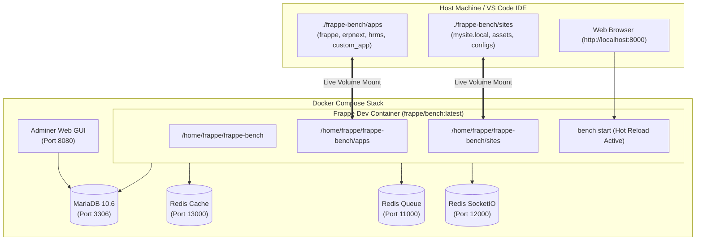

# 🚀 Complete Frappe Framework Setup & Architecture Guide (Team Reference)

> **Document Purpose:** This guide details the complete, production-ready local setup for Frappe Framework (v15 / v16 develop). It is structured sequentially:
> 1. **Base Environment Setup First:** System Packages (`mariadb-client`, `redis-tools`), Docker & Compose, NVM -> Node.js, `uv` -> Python & Bench.
> 2. **Docker Compose Infrastructure:** MariaDB, Redis (Cache, Queue, SocketIO), Adminer, and official `frappe/bench:latest` dev container with live code sync.
> 3. **App Development:** Installing ERPNext, HRMS, and Custom Apps.
> 4. **Automation:** Permanent dynamic asset symlinks (`scripts/setup_symlinks.py`).
> 5. **Troubleshooting Index:** All 6 encountered bugs and verified fixes.

---

## 📑 Table of Contents
1. [Phase 1: Base Environment & Host Prerequisites (Do This First)](#phase-1-base-environment--host-prerequisites-do-this-first)
   - [1.1 System Build Tools & Client Utilities](#11-system-build-tools--client-utilities)
   - [1.2 Docker & Docker Compose Setup](#12-docker--docker-compose-setup)
   - [1.3 NVM -> Node.js 20 LTS & Yarn Setup](#13-nvm---nodejs-20-lts--yarn-setup)
   - [1.4 `uv` -> Python 3.14/3.12 & Frappe Bench Setup](#14-uv---python-314312--frappe-bench-setup)
2. [Phase 2: Docker Compose Infrastructure (DB, Redis, Adminer & Frappe Dev Image)](#phase-2-docker-compose-infrastructure)
   - [2.1 Complete `docker-compose.yml`](#21-complete-docker-composeyml)
   - [2.2 Architecture Diagram](#22-architecture-diagram)
   - [2.3 Start Services & Adminer Verification](#23-start-services--adminer-verification)
3. [Phase 3: Automated & Permanent Symlink Manager (`setup_symlinks.py`)](#phase-3-automated--permanent-symlink-manager)
4. [Phase 4: Bench Initialization & Site Creation](#phase-4-bench-initialization--site-creation)
   - [4.1 Initialize Bench](#41-initialize-bench)
   - [4.2 Adjust `Procfile` for Docker Redis](#42-adjust-procfile-for-docker-redis)
   - [4.3 Create Site `mysite.local`](#43-create-site-mysitelocal)
   - [4.4 Multi-Tenancy & Host Resolution (`localhost`)](#44-multi-tenancy--host-resolution-localhost)
5. [Phase 5: Installing ERPNext & HRMS (Live Code Sync)](#phase-5-installing-erpnext--hrms-live-code-sync)
6. [Phase 6: Everyday Development Workflow](#phase-6-everyday-development-workflow)
7. [Phase 7: New Team Member Quick Start (3-Minute Onboarding)](#phase-7-new-team-member-quick-start)
8. [Phase 8: Complete Troubleshooting & Bug Fixes Index](#phase-8-complete-troubleshooting--bug-fixes-index)

---

## Phase 1: Base Environment & Host Prerequisites (Do This First)

Before running Docker Compose or initializing Frappe, ensure your host operating system (Ubuntu / Debian Linux) has all the foundational tools configured in this exact order:

### 1.1 System Build Tools & Client Utilities
Frappe requires C/C++ compilation headers, git, and specifically client CLI tools (`mariadb-client` and `redis-tools`) on the host machine:

```bash
sudo apt update
sudo apt install -y git curl build-essential libmariadb-dev mariadb-client redis-tools
```

> [!IMPORTANT]
> **Why `mariadb-client` is mandatory on the host:**
> Even though MariaDB runs in a Docker container, `bench new-site` requires the `mariadb` (or `mysql`) CLI command on the **host machine** to import initial SQL schemas into the database container.

---

### 1.2 Docker & Docker Compose Setup
Ensure Docker Engine and Docker Compose are installed and your user has permissions to run docker without `sudo`:

```bash
# 1. Install Docker & Docker Compose plugin (if not already installed)
sudo apt install -y docker.io docker-compose-plugin docker-compose

# 2. Add your current user to the docker group
sudo usermod -aG docker $USER

# 3. Verify Docker & Compose
docker --version
docker-compose --version
```
*(If you just added your user to the `docker` group, log out and log back in or run `newgrp docker`)*.

---

### 1.3 NVM -> Node.js 20 LTS & Yarn Setup
Frappe uses Node.js and Yarn (Classic 1.x) to build Desk, Vue components, and frontend assets. **Node 20 LTS** is the official standard.

```bash
# 1. Install NVM (Node Version Manager)
curl -o- https://raw.githubusercontent.com/nvm-sh/nvm/v0.40.1/install.sh | bash
source ~/.bashrc

# 2. Install Node 20 LTS and set as default
nvm install 20
nvm use 20
nvm alias default 20

# 3. Install Yarn (Classic 1.x) globally
npm install -g yarn

# 4. Verify Node & Yarn versions
node -v   # Should output: v20.x.x
yarn -v   # Should output: 1.22.x
```

---

### 1.4 `uv` -> Python 3.14/3.12 & Frappe Bench Setup
`uv` is Astral's blazing-fast Python package and project manager. We use it to download Python, pin project versions, manage virtual environments, and install `frappe-bench`.

```bash
# 1. Install uv
curl -LsSf https://astral.sh/uv/install.sh | sh
source $HOME/.local/bin/env

# 2. Install Python 3.14 (or 3.12) via uv
uv python install 3.14

# 3. List installed Python versions to verify
uv python list

# 4. Set up project workspace with uv (Inside your project directory, e.g. 1.Installation_part)
uv init --python 3.14
uv python pin 3.14
uv venv
source .venv/bin/activate

# 5. Verify active Python version
python --version   # Should output: Python 3.14.x (or 3.12.x)

# 6. Install frappe-bench CLI globally via uv tool
uv tool install frappe-bench --python 3.14

# 7. Verify bench CLI installation
bench --version   # Should output: 5.x.x
```

---

## Phase 2: Docker Compose Infrastructure

Save the following complete [docker-compose.yml](file:///media/ashraful/b8df7bae-e9ee-4f20-83ce-3bc9e63a05d4/Practise_Code/Frappe16/1.Installation_part/docker-compose.yml) in your project root:

### 2.1 Complete `docker-compose.yml`

```yaml
services:
  mariadb:
    image: mariadb:10.6
    container_name: frappe-mariadb
    restart: unless-stopped
    environment:
      MYSQL_ROOT_PASSWORD: root
    command:
      - --character-set-server=utf8mb4
      - --collation-server=utf8mb4_unicode_ci
      - --skip-character-set-client-handshake
      - --skip-innodb-read-only-compressed
      - --max-allowed-packet=64M
    ports:
      - "3306:3306"
    volumes:
      - mariadb_data:/var/lib/mysql

  redis-cache:
    image: redis:6.2-alpine
    container_name: frappe-redis-cache
    restart: unless-stopped
    ports:
      - "13000:6379"

  redis-queue:
    image: redis:6.2-alpine
    container_name: frappe-redis-queue
    restart: unless-stopped
    ports:
      - "11000:6379"

  redis-socketio:
    image: redis:6.2-alpine
    container_name: frappe-redis-socketio
    restart: unless-stopped
    ports:
      - "12000:6379"

  adminer:
    image: adminer:latest
    container_name: frappe-db-adminer
    restart: unless-stopped
    ports:
      - "8080:8080"

  frappe:
    image: frappe/bench:latest
    container_name: frappe-dev
    restart: unless-stopped
    command: >
      bash -c "sudo chown -R frappe:frappe /home/frappe/frappe-bench/env &&
               python3 scripts/setup_symlinks.py &&
               if [ ! -f /home/frappe/frappe-bench/env/bin/python ]; then
                 UV_VENV_CLEAR=1 bench setup env
               fi &&
               bench start"
    environment:
      - SHELL=/bin/bash
    ports:
      - "8000:8000"
      - "9000:9000"
    volumes:
      - ./frappe-bench:/home/frappe/frappe-bench
      - bench_env:/home/frappe/frappe-bench/env
    working_dir: /home/frappe/frappe-bench
    depends_on:
      - mariadb
      - redis-cache
      - redis-queue
      - redis-socketio

volumes:
  mariadb_data:
  bench_env:
```

---

### 2.2 Architecture Diagram



---

### 2.3 Start Services & Adminer Verification
Start the infrastructure containers:
```bash
docker-compose up -d
```

Verify in `docker-compose ps`:
- `frappe-mariadb`: `localhost:3306` (User: `root`, Password: `root`)
- `frappe-redis-cache`: `localhost:13000`
- `frappe-redis-queue`: `localhost:11000`
- `frappe-redis-socketio`: `localhost:12000`
- `frappe-db-adminer`: `http://localhost:8080`
  *(Login: System: `MySQL`, Server: `mariadb`, Username: `root`, Password: `root`)*

---

## Phase 3: Automated & Permanent Symlink Manager (`setup_symlinks.py`)

When mounting code folders from host to container, absolute host paths (e.g. `/media/ashraful/...`) break asset links inside Docker. 
To make this **100% dynamic and permanent without any manual intervention**, create [frappe-bench/scripts/setup_symlinks.py](file:///media/ashraful/b8df7bae-e9ee-4f20-83ce-3bc9e63a05d4/Practise_Code/Frappe16/1.Installation_part/frappe-bench/scripts/setup_symlinks.py):

```python
#!/usr/bin/env python3
"""
setup_symlinks.py - Permanent Relative Symlink Manager for Frappe Bench
"""
import os
import sys

def ensure_relative_link(link_path, target_path, label=""):
    rel_target = os.path.relpath(target_path, os.path.dirname(link_path))
    if os.path.islink(link_path):
        current_target = os.readlink(link_path)
        if current_target != rel_target:
            os.unlink(link_path)
            os.symlink(rel_target, link_path)
            print(f"✔ [Auto-Fix] Repaired symlink ({label}): {link_path} -> {rel_target}")
    elif not os.path.exists(link_path):
        os.symlink(rel_target, link_path)
        print(f"✔ [Auto-Fix] Created symlink ({label}): {link_path} -> {rel_target}")

def fix_all_symlinks(bench_dir="."):
    bench_dir = os.path.abspath(bench_dir)
    apps_dir = os.path.join(bench_dir, "apps")
    assets_dir = os.path.join(bench_dir, "sites", "assets")
    sites_dir = os.path.join(bench_dir, "sites")
    os.makedirs(assets_dir, exist_ok=True)

    if os.path.isdir(apps_dir):
        for app in os.listdir(apps_dir):
            app_path = os.path.join(apps_dir, app)
            if not os.path.isdir(app_path):
                continue
            app_public = os.path.join(app_path, app, "public")
            app_node_modules = os.path.join(app_path, "node_modules")
            if os.path.isdir(app_public):
                ensure_relative_link(os.path.join(assets_dir, app), app_public, f"Asset: {app}")
                if os.path.isdir(app_node_modules):
                    ensure_relative_link(os.path.join(app_public, "node_modules"), app_node_modules, f"NodeModules: {app}")

    if os.path.isdir(sites_dir):
        default_site = "mysite.local"
        if os.path.isdir(os.path.join(sites_dir, default_site)):
            localhost_link = os.path.join(sites_dir, "localhost")
            if not os.path.exists(localhost_link):
                os.symlink(default_site, localhost_link)
                print(f"✔ [Site Auto-Fix] Linked sites/localhost -> {default_site}")

if __name__ == "__main__":
    fix_all_symlinks(sys.argv[1] if len(sys.argv) > 1 else ".")
```

Make it executable:
```bash
chmod +x frappe-bench/scripts/setup_symlinks.py
```

---

## Phase 4: Bench Initialization & Site Creation

### 4.1 Initialize Bench
From your project directory (`1.Installation_part`), initialize bench using the `uv`-managed Python binary:

```bash
# Frappe 16 (Develop Branch)
bench init --frappe-branch develop --python $(uv python find 3.14) frappe-bench

# Or Frappe v15 (Stable Branch)
# bench init --frappe-branch version-15 --python $(uv python find 3.14) frappe-bench

cd frappe-bench
```

---

### 4.2 Adjust `Procfile` for Docker Redis
Open `frappe-bench/Procfile` and:
1. Comment out `redis_cache` and `redis_queue` (since Docker Compose runs them).
2. Add `--host 0.0.0.0` to `web` server so it can be reached outside the container.

```text
# redis_cache: redis-server config/redis_cache.conf
# redis_queue: redis-server config/redis_queue.conf

web: bench serve --port 8000 --host 0.0.0.0
socketio: bench socketio
watch: bench watch
schedule: bench schedule
worker: bench worker 1>> logs/worker.log 2>> logs/worker.error.log
```

---

### 4.3 Create Site `mysite.local`
Connect to the Docker MariaDB container and create your initial site:

```bash
bench new-site mysite.local --db-host 127.0.0.1 --db-port 3306 --db-root-password root
```
*(When prompted, set your Administrator password, e.g., `admin`)*.

---

### 4.4 Multi-Tenancy & Host Resolution (`localhost`)
Frappe uses HTTP `Host` headers to select which site to serve.
Run this inside `frappe-bench/` to make `http://localhost:8000` resolve directly:

```bash
ln -s mysite.local sites/localhost
bench use mysite.local
```
*(Optional: You can also add `127.0.0.1 mysite.local` to `/etc/hosts` to browse via `http://mysite.local:8000`)*.

---

## Phase 5: Installing ERPNext & HRMS (Live Code Sync)

With Frappe running in the `frappe-dev` container and `./frappe-bench` volume-mounted, install ERPNext and HRMS directly via `docker exec`:

### 1. Install ERPNext:
```bash
# 1. Download ERPNext repository into ./frappe-bench/apps/erpnext
docker exec -it frappe-dev bench get-app erpnext

# 2. Install ERPNext into your site
docker exec -it frappe-dev bench --site mysite.local install-app erpnext
```

### 2. Install HRMS (Frappe HR):
```bash
# 1. Download HRMS repository into ./frappe-bench/apps/hrms
docker exec -it frappe-dev bench get-app hrms

# 2. Install HRMS into your site
docker exec -it frappe-dev bench --site mysite.local install-app hrms
```

> [!NOTE]
> All code for `erpnext` and `hrms` will appear directly on your host machine in `./frappe-bench/apps/`. You can edit them in VS Code; changes hot-reload automatically inside the container.

---

## Phase 6: Everyday Development Workflow

### Convenience Alias:
Add this shortcut alias to your `~/.bashrc`:
```bash
alias dbench='docker exec -it frappe-dev bench'
```

### Common Commands:
| Task | Command |
| :--- | :--- |
| **Start full stack** | `docker-compose up -d` |
| **Stop full stack** | `docker-compose down` |
| **View live logs** | `docker logs -f frappe-dev` |
| **Shell inside container** | `docker exec -it frappe-dev bash` |
| **Create new custom app** | `dbench new-app my_custom_app` |
| **Install custom app on site** | `dbench --site mysite.local install-app my_custom_app` |
| **Run migrations** | `dbench --site mysite.local migrate` |
| **Reset Admin password** | `dbench --site mysite.local set-admin-password admin` |

---

## Phase 7: New Team Member Quick Start

When a new team member clones this repository, **they do NOT need to install Python, Node, NVM, MariaDB, or Redis on their machine**. Everything runs inside Docker!

### Requirements:
- Git
- Docker & Docker Compose

### 3-Step Setup:
```bash
# 1. Clone & enter project
git clone <repository_url>
cd 1.Installation_part

# 2. Start all Docker containers
docker-compose up -d

# 3. Create the local site (One-time only)
docker exec -it frappe-dev bench new-site mysite.local --db-host mariadb --db-port 3306 --db-root-password root --admin-password admin
```

### Access System:
👉 Open **`http://localhost:8000`**  
- **Email:** `Administrator`  
- **Password:** `admin`

---

## Phase 8: Complete Troubleshooting & Bug Fixes Index

### 🐛 Issue 1: `Bind for 0.0.0.0:5432 failed: port is already allocated`
- **Cause:** Another local PostgreSQL service or Docker container (e.g. Odoo) is already using port `5432`.
- **Fix:** If PostgreSQL is not needed for Frappe, remove it from `docker-compose.yml`. If needed, map to an alternate port like `"5433:5432"`.

### 🐛 Issue 2: `frappe.exceptions.ExecutableNotFound: mariadb not found in PATH!`
- **Cause:** The site installer needs the `mariadb` CLI command on the host to restore SQL schemas.
- **Fix:** Install `mariadb-client` on the host:
  ```bash
  sudo apt install -y mariadb-client
  ```

### 🐛 Issue 3: `Could not create server TCP listening socket 127.0.0.1:11000: bind: Address already in use`
- **Cause:** `bench start` is trying to start local redis instances that conflict with Docker Redis containers.
- **Fix:** In `frappe-bench/Procfile`, comment out `redis_cache` and `redis_queue`.

### 🐛 Issue 4: `Not Found: localhost does not exist`
- **Cause:** Browser sends `Host: localhost`, but the site name is `mysite.local`.
- **Fix:** Link `localhost` to `mysite.local` via `ln -s mysite.local sites/localhost` and run `bench use mysite.local`.

### 🐛 Issue 5: Where is the Administrator password stored? How to reset?
- **Answer:** The password is NOT stored in any plaintext file. It is securely hashed inside the MariaDB database.
- **Reset Command:**
  ```bash
  bench --site mysite.local set-admin-password <new_password>
  ```

### 🐛 Issue 6: Login page has no CSS / Unstyled plain HTML (Broken Asset Symlink in Docker)
- **Cause:** When Frappe initializes on the host, it creates absolute symlinks in `sites/assets/` pointing to host paths like `/media/ashraful/...`. Inside Docker, those host paths don't exist, breaking CSS/JS asset loading.
- **Permanent & Automated Solution:** We implemented `frappe-bench/scripts/setup_symlinks.py`, which is hooked directly into `docker-compose.yml`.
  - Every time `docker-compose up -d` runs, it automatically scans all apps in `apps/` (`frappe`, `erpnext`, `hrms`, custom apps) and ensures all asset and node_modules symlinks are converted to relative paths (`../../apps/...`).
  - **No manual fixing is required by any team member.**
